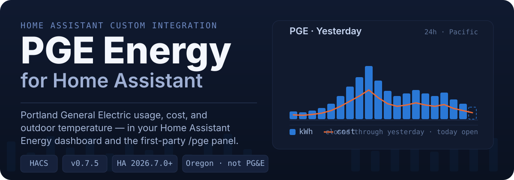
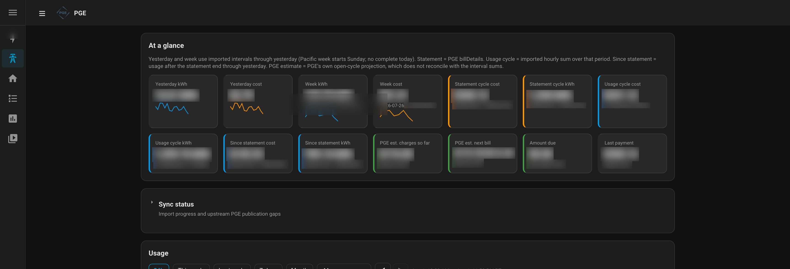
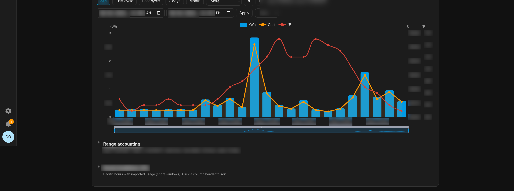
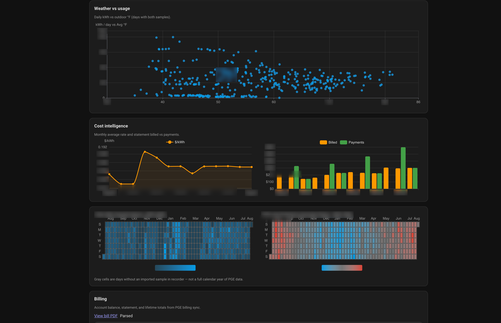
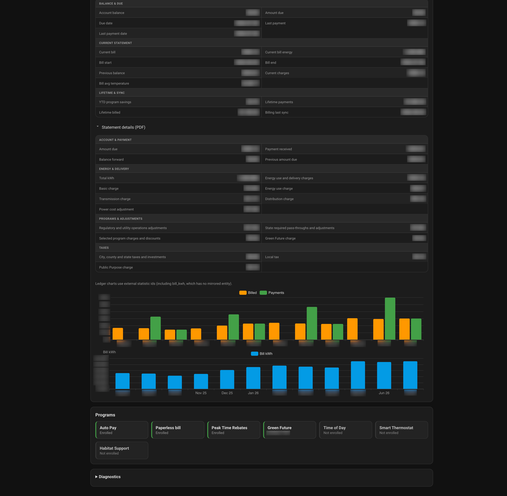
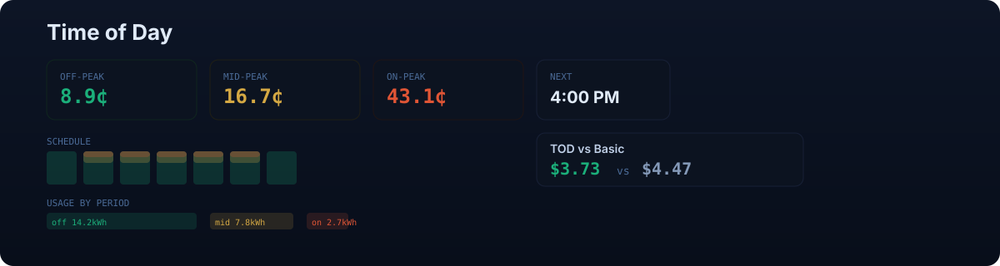
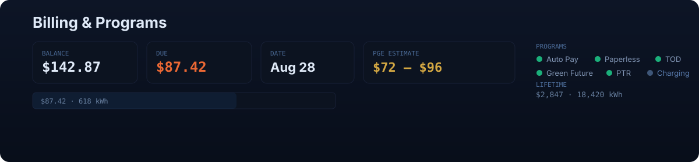
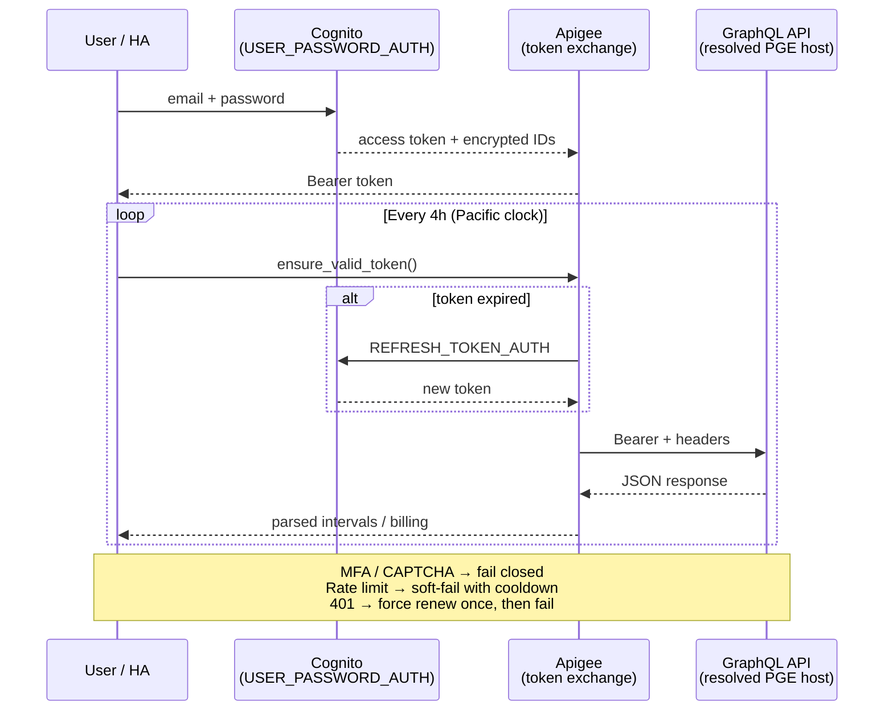
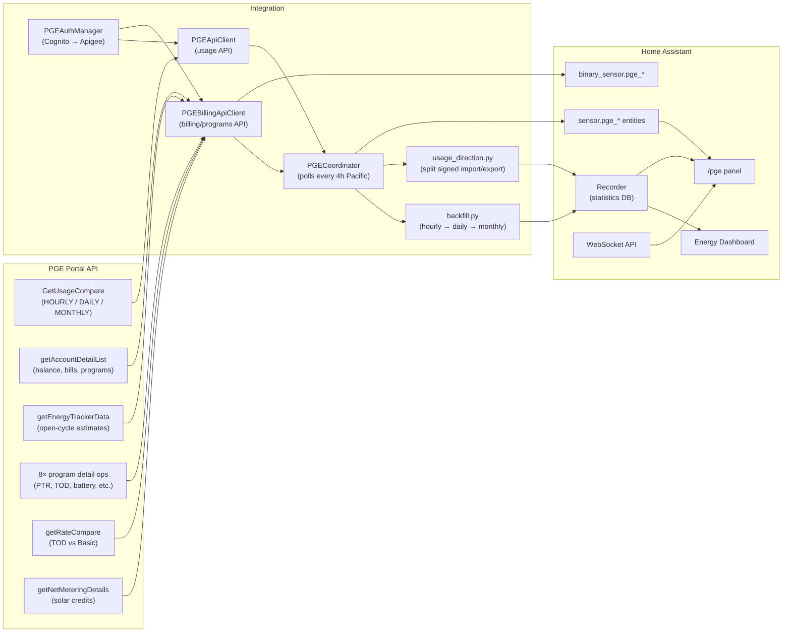
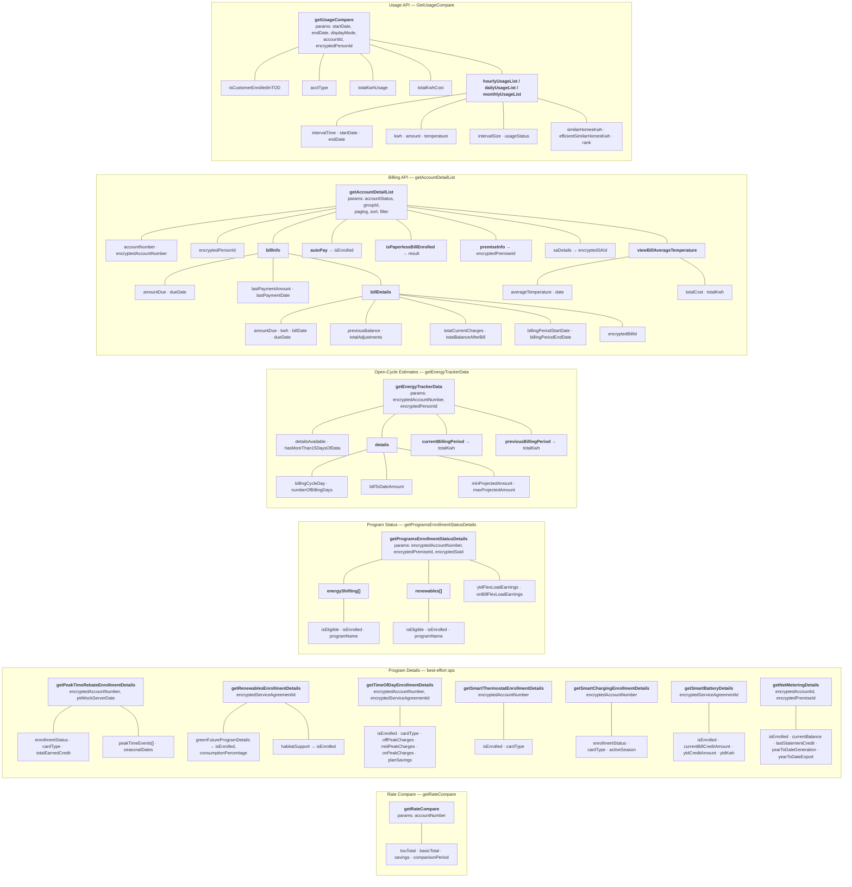

# Portland General Electric (PGE) Energy for Home Assistant



Home Assistant custom integration for **Portland General Electric (PGE)** — imports your energy usage, billing, and Time of Day pricing into the HA Energy dashboard and a first-party `/pge` panel, using PGE's own in-house portal GraphQL API (not Opower, not HTML scraping).

> **Not Pacific Gas & Electric (PG&E).** This is for [Portland General Electric](https://portlandgeneral.com/) in Oregon. It does **not** work with California PG&E / Opower integrations.
>
> **Unsupported / unofficial:** MFA- and CAPTCHA-enabled PGE accounts are not supported (fail closed). The portal API is unofficial and may change without notice. Not affiliated with or endorsed by Portland General Electric.

**Requires Home Assistant 2026.7.0+.**

---

## Installation

### HACS (recommended)

1. HACS → **⋯** → **Custom repositories**, add `https://github.com/spencerthayer/homeassistant-pge` with category **Integration**.
2. Install **Portland General Electric Energy Usage** (version matches the latest GitHub Release, e.g. `0.12.1`).
3. Restart Home Assistant.

### Manual

1. Copy `custom_components/pge_energy` into `config/custom_components/`.
2. Restart Home Assistant.

## Setup

1. Settings → Devices & Services → **Add Integration** → _Portland General Electric Energy Usage_.
2. Enter PGE **email**, **password**, and **account number** (one entry per account).
3. The same login can own multiple entries with different account numbers; each login's password is stored in that entry.
4. **MFA-enabled PGE accounts are not supported** — if PGE requires MFA or CAPTCHA, setup fails closed.

Setup validates connectivity with an hourly request for yesterday, then the first sync backfills history.

---

## The panel

A first-party Home Assistant panel at `/pge` — usage, cost, outdoor temperature, billing, programs, Time of Day pricing, and live sync progress for all configured accounts.


_At a glance — yesterday and week totals, statement and since-statement sums, PGE's own open-cycle estimates, amount due. Click any KPI tile to copy its value._


_Usage — hourly kWh bars with a cost series, grid flow for solar accounts, plus Range accounting and per-hour breakdown tables._

<p align="center">
  
  
  <br><em>Analytics — weather vs usage and cost intelligence · Billing — balance, statements, bill PDFs, programs.</em>
</p>

---

## What it does


- **Hourly → daily → monthly usage history** (kWh, cost, outdoor temperature) imported into HA Energy statistics, with tiered backfill of your full account history.
- **Dual-published data**: every series is both a `sensor.pge_*` entity and a `pge_energy:*` statistic, so it works in the Energy dashboard, History, and the entity Statistics graph.
- **Time of Day pricing hub** — current E-TOU period/rate KPIs, next-transition countdown, weekly schedule grid (Sun–Sat × 24h Pacific), usage bucketed by period, and a local TOD imported-energy estimate that compares TOD pricing to Basic rates.



- **Billing & programs** sensors — balance, amount due, statements, lifetime totals, autopay/paperless/PTR/Green Future/Time-of-Day enrollment, and PGE's open-cycle estimates.



- **Bill PDFs (opt-in)** — download statement PDFs, parse them locally with `pypdf`, reconcile against GraphQL, and import 18 statement-dated statistics.


- **Multi-account discovery** — one PGE login automatically discovers all active accounts; each gets its own config entry, device, and statistics.


- **Solar / net-metering** — signed HOURLY grid import/export split into `_consumption` / `_return` (and `_cost` / `_compensation`) for the Energy dashboard and panel.
- **Unattended login** — PGE email/password (Cognito → Apigee), stored locally with automatic token renewal; rate limits soft-fail instead of locking your account.
- **Resilient by default** — auth or sync failures keep your last-known sensors and recorder history; long backfills self-heal on stall; sync status always reaches a terminal state.

## How it works

A single `PGECoordinator` authenticates once per entry, then polls PGE's GraphQL endpoint on a Pacific sync clock (default **every 4 hours** from **12:00 AM** — 12am/4am/8am/noon/4pm/8pm). Closed intervals are imported as statistics; the `/pge` panel reads those same recorder statistics for its charts. Auth chain and data model details live in [`docs/ARCHITECTURE.md`](docs/ARCHITECTURE.md) and [`docs/DATA_CONTRACT.md`](docs/DATA_CONTRACT.md).

PGE publishes usage **once overnight**, so a "stuck" latest interval near `01:00` Pacific during the day is expected — not a sync failure.

### Connection architecture



### Data extraction pipeline



### Complete GraphQL operations map

Every GraphQL operation this integration calls, with all extracted fields:



---

## Usage

### Energy Dashboard

The Energy dashboard needs the external statistic. The lifetime sensors are a second series.

1. Settings → Dashboards → Energy → **Add consumption**.
2. Pick **`PGE <account> grid consumption`**.
   - The statistic id is `pge_energy:<account_key>_consumption`. Copy it from the `external_statistic_id` attribute on `sensor.pge_<account_number>_energy` (More info).
   - The middle segment is an opaque `account_key` hash. The account number is in the label, so search for that number ([#10](https://github.com/spencerthayer/homeassistant-pge/issues/10)).
3. Leave **Lifetime import** (`sensor.pge_<account_number>_energy`) out of Grid consumption. That sensor is the lifetime total. Backfill and repairs write the external series.
4. Solar / net-metered accounts: add **`PGE <account> return to grid`** (`pge_energy:<account_key>_return`) for **Return to grid**. Add **`PGE <account> energy cost`** and **`PGE <account> export compensation`** when those slots are wanted.

Do **not** use for Grid consumption:

- **Lifetime import** / `sensor.pge_*_energy`
- `sensor.pge_*_hourly_energy` — latest closed hour tip only
- `sensor.pge_*_current_day_energy` — Pacific day total that resets

If the dashboard shows a huge negative kWh spike, the grid source is on the lifetime sensor. Switch it to **`PGE <account> grid consumption`**, and to **`PGE <account> return to grid`** when the account generates. Clear any stale orphaned `pge_energy:*` ids under Developer Tools → Statistics.

### PGE panel `/pge`

The integration registers `/pge` and (for admin users, by default) a sidebar item **PGE**. Use it for usage, cost, temperature, billing, programs, Time of Day pricing, and live sync progress:

- **At a glance** — yesterday and week (Pacific Sunday → yesterday) kWh/cost, statement and since-statement sums, PGE estimate cards, amount due. Click any KPI tile to copy its label, value, and note to the clipboard.
- **Sync status** — collapsible import progress and PGE publication gaps, placed immediately above Diagnostics.
- **Usage** — combined multi-series chart. For generating accounts, **grid flow** bars go above zero for import and below zero for export (Opower/HA Energy style); the money line is **import cost**, or **net interval amount** (`cost − compensation`) when export credits are present in the range — an interval estimate, not PGE's statement credit bank. Ranges end at Pacific midnight of the current day. Fast-select: **24h / This cycle / Last cycle / 7 days / Month**, with **More…** for `6h`/`12h`/`3mo`/`6mo`/`12mo`/YTD. **Range accounting** uses the same signed projection.
- **Analytics** — weather vs usage (daily kWh vs outdoor °F) and cost intelligence (monthly average rate, billed vs payments).
- **Billing** — balance, statements, lifetime totals, and programs; when bill PDFs are enabled, **View bill PDF** + **Statement details (PDF)**.
- **Time of Day** — current E-TOU period/rate KPIs with a next-transition countdown, an enrollment badge, and the week schedule grid (Sun–Sat × 24h Pacific) highlighting the current hour. Usage is bucketed by period (energy, imported cost, TOD-priced, share, avg billed ¢/kWh). The local comparison **hero** is TOD-priced kWh vs **billed imported energy** for a window chosen **in the Time of Day section** (24h / This cycle / Last cycle / 7 days / Month / More… / custom; default Last cycle; independent of the Usage chart range). A collapsed **How this was calculated** table also shows the offline/portal **rate-card** TOD vs Basic model (kWh × published/default ¢ — not billed). Official PGE `getRateCompare` savings stay a separate card when the portal returns them. Holiday/off-peak days for the current year are listed in a collapsed note.
- Configure → **Panel** customizes the sidebar link (show/hide, title, icon), the admin gate, and the default landing section (including **Time of Day**). Hiding the link does **not** unregister `/pge` — it stays reachable by URL.

## Panel charts

Every chart on `/pge` ends at published data (Pacific yesterday). Gallery charts do not follow the Usage range chip. A chart with fewer than two finite points is omitted. Portal `_cost` is the PGE usage estimate. Catalog prices are the local TOD imported-energy estimate.

#### Usage combo

- Where: `#chart-usage` in Usage.
- Represents: Grid import above zero, grid export below zero, the PGE usage estimate, and outdoor °F.
- Data: `consumption`, `return`, `cost`, `compensation`, and `temperature` through `fetchStatisticSeries` and `projectDirectionalUsage`. The money line is `cost`, or `cost` minus `compensation` when that range has a positive compensation credit.
- Window: The selected Usage range, ending at `publishedDataEnd`.

#### Weather vs usage

- Where: `#scatter` in Analytics.
- Represents: One point per closed day: daily kWh against that day's mean outdoor °F.
- Data: Daily `consumption` values and `temperature` means. Days need both samples and kWh above 0.
- Window: The selected Usage range.

#### Monthly average rate

- Where: `#cost-per-kwh` in Analytics.
- Represents: Portal dollars per kWh by month.
- Data: Monthly `consumption` and `cost`.
- Window: The selected Usage range.

#### Billed vs payments

- Where: `#billed-paid` in Analytics.
- Represents: Statement billed dollars against payments.
- Data: `bill_amount` and `payment_amount`.
- Window: Monthly, the selected Usage range.

#### kWh calendar

- Where: `#heatmap-kwh` in Analytics.
- Represents: One cell per day of imported kWh. A gray cell is a day with no imported sample.
- Data: Daily `consumption`.
- Window: The selected Usage range.

#### Temperature calendar

- Where: `#heatmap-temp` in Analytics.
- Represents: One cell per day of mean outdoor °F. A gray cell is a day with no imported sample.
- Data: Daily `temperature` means.
- Window: The selected Usage range.

#### Ledger dollars

- Where: `#ledger-bill` inside Billing.
- Represents: Billed amount and payments.
- Data: `bill_amount` and `payment_amount`, `period: "month"`.
- Window: The `12mo` preset.

#### Ledger kWh

- Where: `#ledger-kwh` inside Billing.
- Represents: Billed kWh.
- Data: `bill_kwh`, `period: "month"`.
- Window: The `12mo` preset.

#### Glance sparklines

- Where: KPI tiles in `#kpis`.
- Represents: A short recent trend beside the glance numbers.
- Data: The same recorder series those KPI sums already use. SVG, not ECharts.
- Window: The short window each glance tile already uses.

#### Week schedule

- Where: `#tod` `.tod-grid`.
- Represents: Pacific weekday by hour, colored off-peak, mid-peak, and on-peak. This is the schedule, not measured usage.
- Data: `todPeriodForPacific`. No recorder series.
- Window: The current Pacific week grid.

#### Period share bar

- Where: `#tod` `.tod-share-bar`.
- Represents: Share of imported kWh in off-peak, mid-peak, and on-peak.
- Data: Hourly `consumption` classified by `todPeriodForPacific`.
- Window: The Time of Day range.

#### Typical day

- Where: Load shape details in Usage, `#chart-typical-day`.
- Represents: Weekday and weekend mean kWh by Pacific hour.
- Data: `typicalDayProfiles` on hourly `consumption`.
- Window: Last 28 published days. Hidden with fewer than two finite points.

#### Hour by weekday heatmap

- Where: Load shape details, `#chart-hour-weekday`.
- Represents: Mean kWh on a Sunday-first grid of weekday by hour.
- Data: `hourWeekdayMatrix` on hourly `consumption`.
- Window: Last 28 published days. Hidden with fewer than two finite points.

#### Monthly ridgelines

- Where: Load shape details, `#chart-ridgelines`.
- Represents: Mean hourly shape for each Pacific month, drawn as separate ridges.
- Data: `monthRidges` on hourly `consumption`.
- Window: Last 12 published months. A month with no hourly samples is omitted.

#### 24-hour polar clock

- Where: Load shape details, `#chart-polar`.
- Represents: Weekday mean kWh by Pacific hour.
- Data: `typicalDayProfiles` on hourly `consumption`.
- Window: Last 28 published days. Hidden with fewer than two finite points.

#### Daily kWh histogram

- Where: Load shape details, `#chart-histogram`.
- Represents: How many closed days fall in each daily kWh bin.
- Data: `histogramBins` on daily `consumption`.
- Window: Last 5 published years. Hidden with fewer than two finite points.

#### Year over year

- Where: Load shape details, `#chart-yoy`.
- Represents: Daily kWh summed by month, one series per year present.
- Data: `monthlyByYear` on daily `consumption`.
- Window: Last 5 published years. Hidden with fewer than two finite points.

#### Billing-cycle race

- Where: Load shape details, `#chart-cycle-race`.
- Represents: Cumulative imported kWh by day of the statement, current window against the previous window of the same length.
- Data: `cycleCumulative` on hourly `consumption`. Bounds come from `current_bill_start` and `current_bill_end`.
- Window: Previous statement start through `publishedDataEnd`. Hidden when bounds are missing or fewer than two points remain.

#### Baseload band

- Where: Load shape details, `#chart-baseload`.
- Represents: Weekday hourly mean, with a line at the minimum of Pacific hours 0 through 5.
- Data: `typicalDayProfiles` and `baseloadFloor` on hourly `consumption`.
- Window: Last 28 published days. Hidden with fewer than two finite points.

#### Daily spread band

- Where: Load shape details, `#chart-spread`.
- Represents: Daily kWh, the mean, and the mean plus or minus two sample standard deviations.
- Data: `spreadBand` on daily `consumption`.
- Window: Last 5 published years. Hidden with fewer than two finite points.

#### Published week

- Where: Load shape details, `#chart-published-week`.
- Represents: Hourly kWh for the latest fully closed Pacific Sunday-through-Saturday week.
- Data: `publishedWeekDays` on hourly `consumption`.
- Window: That closed week, ending before `publishedDataEnd`. Hidden when the week is incomplete.

#### Day fingerprint

- Where: Load shape details, `#chart-fingerprint`.
- Represents: Each closed day as kWh, peak hour, mean °F, on-peak share, and portal cents per kWh.
- Data: `dayFingerprints` on hourly `consumption`, `cost`, and `temperature`. Days without temperature are skipped.
- Window: Last 28 published days. Hidden with fewer than two finite points.

#### Duck curve

- Where: Load shape details, `#chart-duck` and `#chart-duck-months`.
- Represents: Import and export by hour, and by month the import, export, PGE usage estimate, and export compensation.
- Data: `duckHourProfiles` and `duckMonthBars` on hourly `consumption` and `return`, plus monthly `cost` and `compensation`.
- Window: Last 28 published days for the hour profile, last 12 published months for the month bars. Hidden unless `hasExport` is true.

#### Stacked area

- Where: Time of Day Charts details, `#chart-tod-stacked`.
- Represents: Hourly imported kWh stacked by off-peak, mid-peak, and on-peak.
- Data: Hourly `consumption` classified with `todPeriodForPacific`.
- Window: Last 28 published days. Hidden with fewer than two finite points.

#### Monthly period mix

- Where: Time of Day Charts details, `#chart-period-mix`.
- Represents: Each Pacific month as a 100% stack of the three periods.
- Data: `periodMixByMonth` on hourly `consumption`.
- Window: Last 12 published months. Hidden with fewer than two finite points.

#### Money-hours Pareto

- Where: Time of Day Charts details, `#chart-money-pareto`.
- Represents: The hours that contribute the most local TOD imported-energy estimate, at most eight.
- Data: `moneyHourPareto` on hourly `consumption` times the catalog rate from `estimatePlanCostSeries`.
- Window: Last 28 published days. Hidden when catalog coverage is incomplete or fewer than two points remain.

#### kWh by period

- Where: Time of Day Charts details, `#chart-period-box`.
- Represents: The spread of hourly kWh inside off-peak, mid-peak, and on-peak.
- Data: `periodBox` on hourly `consumption`.
- Window: Last 28 published days. Hidden with fewer than two finite points.

#### Local Basic minus local TOD

- Where: Time of Day Charts details, `#chart-tod-delta`.
- Represents: Monthly local Basic minus monthly local TOD. Positive means the local TOD estimate is lower.
- Data: `todMinusBasicByMonth` from `estimatePlanCostSeries`. Portal hourly amount is not used.
- Window: Last 12 published months. Hidden when catalog coverage is incomplete.

#### Forward 48-hour ribbon

- Where: Time of Day Charts details, `#chart-forward-ribbon`.
- Represents: The next 48 Pacific hours of the offline schedule, starting at the current hour. Bar height is the historical mean kWh for that weekday and hour. No recorder point is plotted after `publishedDataEnd`.
- Data: `forwardRibbon` using `todPeriodForPacific` and hourly `consumption` means.
- Window: Schedule for the next 48 hours. History is the last 28 published days. Hidden with fewer than two finite points.

#### Sankey

- Where: Time of Day Charts details, `#chart-sankey`.
- Represents: Period kWh flowing into the local TOD imported-energy estimate. Link width is kWh. The target label includes the dollar total.
- Data: `sankeyFlows` from hourly `consumption` and `estimatePlanCostSeries`. A period with 0 kWh is dropped.
- Window: Last 12 published months. Hidden when catalog coverage is incomplete.

#### Degree days vs kWh

- Where: `#insights-weather`, `#chart-degree-days`.
- Represents: Daily imported kWh beside heating and cooling degree days at a 65 °F base.
- Data: `degreeDayPoint` on daily `temperature` means and daily `consumption`.
- Window: Last 5 published years. Hidden with fewer than two finite points.

#### Temperature bins

- Where: `#insights-weather`, `#chart-temp-bins`.
- Represents: Mean daily kWh in outdoor temperature bands: under 40, then each 10 °F band through 80 and above.
- Data: `tempBins` on daily `consumption` and `temperature` means.
- Window: Last 5 published years. Hidden with fewer than two finite points.

#### Statement vs portal estimate

- Where: Billing Charts details, `#chart-statement-portal`.
- Represents: Billed amount against the summed PGE usage estimate. The window is approximate.
- Data: `statementWindows` and `statementGap` on `bill_amount` and hourly `cost`.
- Window: Statement rows present in `bill_amount`. Hidden with fewer than two finite points.

#### Bill kWh vs imported kWh

- Where: Billing Charts details, `#chart-bill-imported`.
- Represents: Billed kWh against summed imported kWh over the same approximate statement windows.
- Data: `statementWindows` and `billVsImported` on `bill_kwh` and hourly `consumption`.
- Window: Statement rows present in `bill_amount`. Hidden with fewer than two finite points.

#### Program savings

- Where: Billing Charts details, `#chart-program-savings`.
- Represents: Year-to-date program savings. This is a mean series, not a cumulative sum.
- Data: `ytd_program_savings` means.
- Window: Last 5 published years of the mean series. Hidden with fewer than two finite points.

#### Balance and amount due

- Where: Billing Charts details, `#chart-balance-due`.
- Represents: Account balance and amount due. These are mean series, not cumulative sums.
- Data: `account_balance` and `amount_due` means.
- Window: Last 5 published years of the mean series. Hidden with fewer than two finite points.

#### Stacked bill anatomy

- Where: Billing Bill PDF details, `#chart-bill-anatomy`.
- Represents: Each statement stacked as basic, energy use, delivery, taxes, and other. Other is new charges minus those four families. Delivery charges are not stacked on top of their parts.
- Data: `billAnatomyRows` on `bill_pdf_statistic_ids`.
- Window: PDF statement rows. The whole Bill PDF block is omitted when every PDF series is empty.

#### Latest statement treemap

- Where: Billing Bill PDF details, `#chart-treemap`.
- Represents: The latest statement's five families.
- Data: `treemapSlices` on the latest PDF row.
- Window: The latest PDF statement. Hidden when the PDF block is omitted or fewer than two slices remain.

#### Statement waterfall

- Where: Billing Bill PDF details, `#chart-waterfall`.
- Represents: Previous amount due, payment received, new charges, and amount due.
- Data: `waterfallSteps` on `previous_amount_due`, `payment_received`, `balance_forward`, and `amount_due`.
- Window: The latest PDF statement. Hidden when the PDF block is omitted.

#### Fixed vs variable

- Where: Billing Bill PDF details, `#chart-fixed-variable`.
- Represents: Basic, energy use, delivery, taxes, and other across statements.
- Data: `fixedVariableRows` on the PDF families.
- Window: PDF statement rows. Hidden when the PDF block is omitted or fewer than two points remain.

#### Line-item mix

- Where: Billing Bill PDF details, `#chart-line-mix`.
- Represents: Those five families as a 100% stack.
- Data: `lineItemShares` on the PDF families.
- Window: PDF statement rows. Hidden when the PDF block is omitted or fewer than two points remain.

#### Why this bill changed

- Where: Billing Charts details, first host, `#chart-bill-explainer`.
- Represents: How much of the change between the last two bills came from days in the cycle, weather, rate, and usage. The bars sum to the change in amount due.
- Data: `billExplainer` and `weatherModel` on the last two approximate statement windows, daily `consumption`, daily `temperature` means, and `bill_amount`. The model is fit on the trailing 365 days.
- Window: Statement rows present in `bill_amount`. Hidden when the model is null or fewer than two windows have daily temperature.

#### Weather-normalized counterfactual

- Where: `#insights-weather`, `#chart-weather-counterfactual`.
- Represents: Actual daily kWh against a weather model fit on an earlier baseline, plus the cumulative kWh gap. The fit is not the days drawn.
- Data: `counterfactual` and `weatherModel` on daily `consumption` and `temperature` means.
- Window: Last 5 published years. Hidden when the baseline is under 300 days, the later window is under 30 days, or the model is null.

#### Always-on load history

- Where: Load shape details, `#chart-baseload-history`.
- Represents: The overnight minimum (Pacific hours 0 through 5) and the steps where that floor changed. Yearly dollars use the trailing 365-day PGE usage estimate.
- Data: `baseloadSteps` on hourly `consumption`, and `centsPerKwh` on trailing daily `cost` and `consumption`.
- Window: All available hourly history. Hidden when the weather model is null or fewer than two points remain.

#### Load-shift simulator

- Where: Time of Day Charts details, first host, `#chart-shift-sim`, with preset, kW, hours, and runs-per-month inputs.
- Represents: What a weekday load costs per month at each start hour. Local TOD imported-energy estimate versus Schedule 7 base plus Schedule 125. That comparison line is not a full Basic bill. Weekends are all off-peak.
- Data: `shiftCostByStartHour` using the catalog row `estimatePlanCostSeries` would use at `publishedDataEnd`.
- Window: A single weekday rate card, not a recorder range. Hidden when the catalog does not cover `publishedDataEnd`.

#### Daypart stream

- Where: Load shape details, `#chart-daypart-stream`.
- Represents: How usage shifts among overnight (0-5), morning (6-11), afternoon (12-16), and evening (17-23).
- Data: `daypartDays` on hourly `consumption`.
- Window: Last 12 published months. Hidden when the weather model is null or fewer than two points remain.

#### Price of a degree

- Where: `#insights-weather`, `#kpi-degree-price`. Text, not a chart.
- Represents: What each 1 °F colder day and each 1 °F hotter day costs, in dollars per degree-day.
- Data: `degreePrice` from `weatherModel` heating and cooling slopes times trailing 365-day portal cents per kWh. Labeled as the PGE usage estimate.
- Window: Trailing 365 published days. Hidden when the model is null.

### Billing & programs

When **Import billing & programs** is on (default), the same device (`PGE <accountnum>`) gains balance, amount due, due date, last payment, current bill amount/kWh/period, previous balance/current charges, bill-period average temperature, YTD program savings, lifetime payments/billed, estimated current charges and next-bill (low/high) from PGE's own open-cycle projection, billing-cycle day/length, and binary sensors for Auto Pay, Paperless, Peak Time Rebates, Green Future, Time of Day, Smart Thermostat, and Habitat Support.

The estimate sensors are PGE's projection (`getEnergyTrackerData`) and will not tie out against sums of imported hourly intervals; they stay unavailable until PGE reports `detailsAvailable`.

### Bill PDFs (opt-in)

Enable **Download bill PDFs** in Configure → Sync settings (requires billing import; default **off**). After each billing sync the integration downloads eligible statement PDFs to `www/pge_energy/<account>/bills/`, parses them locally with `pypdf`, reconciles amount/kWh/period against GraphQL (**fail-closed** on mismatch), and imports 18 statement-dated `_bill_pdf_*` statistics. GraphQL billing sensors remain canonical; the PDF line-item sensors are disabled by default to reduce clutter.

> PDFs under `www/…` are reachable at `/local/…` **without** HA login if your instance is exposed — see [`SECURITY.md`](SECURITY.md).

### Services

All long-running services require `entry_id`:

| Service                              | Purpose                                                                  |
| ------------------------------------ | ------------------------------------------------------------------------ |
| `pge_energy.refresh`                 | Force a poll (optional `entry_id`)                                       |
| `pge_energy.backfill`                | Tiered hourly → daily → monthly backfill over `start_date`–`end_date`    |
| `pge_energy.retry_failed_ranges`     | Retry previously failed import ranges                                    |
| `pge_energy.reset_import_checkpoint` | Reset the backfill watermark (does not delete recorder history)          |
| `pge_energy.download_bill_pdf`       | Download a specific statement PDF (`bill_date`; optional `form`/`force`) |
| `pge_energy.reparse_bill_pdfs`       | Reparse retained PDFs only (no network)                                  |

---

## Configure

Settings → Devices & Services → PGE Energy → **Configure** (from any account entry):

- **Sync settings** — polling (value + minutes/hours/days unit, default **every 4 hours**), **Sync clock** (Pacific, default **12:00 AM**), correction window, history mode/start, hourly history days, auto backfill, cost/diagnostics, **Import billing & programs** (default on), **Download bill PDFs** (default off), **Time of Day rates** (optional overrides for the portal/`basic_service` rate card), concurrency, and the default-off diagnostic capture below.
- **Panel** — integration-wide chrome for `/pge`: show in sidebar (default on), sidebar title (default `PGE`), icon (default `mdi:transmission-tower`), admin-only (default on), default landing section. Sidebar _order_ stays with Home Assistant's sidebar editor / [Browser Mod](https://github.com/thomasloven/hass-browser_mod).
- **Update credentials** — email/password only; the account number is read-only and statistic IDs are unchanged.
- **Manual sync** — force **Refresh now** or **Backfill missing history** (uses your Sync settings). Stays available when the sidebar link is hidden.

Details: [`docs/HA_SETTINGS_HISTORY.md`](docs/HA_SETTINGS_HISTORY.md).

### Grid import/export diagnostic capture

Generating / net-metered accounts publish signed HOURLY usage: positive kWh is grid import, negative kWh is grid export ([#5](https://github.com/spencerthayer/homeassistant-pge/issues/5)). The integration splits those into non-negative `_consumption` / `_return` (and `_cost` / `_compensation`) statistics for the Energy dashboard and `/pge` panel. An off-by-default **Enable diagnostic capture** switch remains available for follow-up GraphQL captures (`PGE_ALPHA_GRID_CAPTURE`); it never logs credentials, tokens, or identifiers.

---

## Sensors & statistics

Every usage series is available in **both** forms:

| Use case                                    | Pick                                                              |
| ------------------------------------------- | ----------------------------------------------------------------- |
| Entity picker, History, most Lovelace cards | `sensor.pge_<account_number>_energy` (**Lifetime import**) / `_return` (**Lifetime export**) / `_cost` (**Lifetime cost**) / `_compensation` (**Lifetime compensation**) / `_outdoor_temperature` |
| Energy dashboard / statistics graphs        | **`PGE <account> grid consumption`** / **return to grid** / **energy cost** / **export compensation** (`pge_energy:<account_key>_consumption` / `_return` / `_cost` / `_compensation` / `_temperature`; see `external_statistic_id` on the lifetime import sensor) |

| Sensor                                     | Description                                               |
| ------------------------------------------ | --------------------------------------------------------- |
| Lifetime import / Lifetime cost            | Lifetime cumulative kWh / USD (entity + mirrored history) |
| Outdoor temperature                        | Latest °F; full history mirrored onto the entity          |
| Hourly energy / cost                       | Latest closed interval values                             |
| Current day / Yesterday energy & cost      | Pacific-local day totals                                  |
| Last successful update / Data age          | Sync freshness                                            |
| Latest available interval                  | Newest PGE interval end                                   |
| Time of Day period / rate                  | Current E-TOU period (`off_peak`/`mid_peak`/`on_peak`) + ¢/kWh rate (v0.9.0+) |
| TOD vs Basic savings                      | Cumulative $ saved vs basic rate (v0.9.0+)                |
| On-device tariff catalogs                 | Effective-dated TOD + Basic rates auto-discovered from PGE public sources (v0.10.0+) |
| Local plan estimates                      | Dual-source TOD vs Basic cost estimates with official reconciliation (v0.10.0+) |
| Authentication expiration / Last API error | Diagnostics (disabled by default)                         |

Billing sensors expose `external_statistic_id` and `entity_statistic_id` for automations and custom cards. Full billing/programs sensor and PDF-statistics catalogs: [`docs/DATA_CONTRACT.md`](docs/DATA_CONTRACT.md).

Time-of-Day rates are resolved per poll: manual overrides → effective-dated on-device catalog (auto-discovered from PGE public sources) → last portal rate card (best-effort GraphQL) → built-in defaults. Set overrides under Configure → **Sync settings** → **Time of Day rates** (`tod_rate_off_peak` / `_mid_peak` / `_on_peak` / `_basic_service`).

---

## Known limitations

- **MFA / CAPTCHA accounts are unsupported** by design (fail closed).
- Cognito login throttle / temporary password lockout is rate-limited with a shared per-email cooldown and soft-failed — the integration never hammers `InitiateAuth`.
- **PGE publishes once overnight.** Hourly intervals for a Pacific day appear after midnight; a stuck `Latest available interval` near `01:00` PT during the day is expected. Polling is 4-hourly on a Pacific clock grid by default.
- Hourly day responses include a +1 boundary hour at `day_end`; the integration clips to `[day_start, day_end)`.
- Full history uses daily/monthly tiers once hourly retention ends (~1 year).
- DAILY windows under ~31 days may hard-error; prefer HOURLY or ≥31-day DAILY.
- MONTHLY returns the latest ~12 billing periods per call; older history requires paging backwards.
- Grid export uses signed HOURLY rows only; DAILY/MONTHLY net totals are not split into gross import/export.
- PGE's hourly temperature records are not _always_ in sync with the energy data.
- PGE has told customers they are moving away from third-party data providers to their own in-house portal, and the Opower-backed endpoints used by the upstream `opower` integration have started returning 503 ([`tronikos/opower#210`](https://github.com/tronikos/opower/issues/210)). This integration talks to PGE's own portal API and is unaffected by that shutdown.
- A dead API host fails over to the next probed origin. HTTP 401, 403, and 429 stay on the host that answered. PGE's API is unofficial and may change without notice.

## Troubleshooting

If PGE moves their API host, set `PGE_API_HOST` to an `https://` origin on `portlandgeneral.com`, or enter that origin under Configure, Sync settings, API host. Hosts outside that domain are ignored unless `PGE_API_HOST_ALLOW_FOREIGN=1`, which is unsupported.

Common issues, including quiet expected log warnings (`pypdf` layout warnings, caught soft-failures), `sqlite3.IntegrityError: UNIQUE constraint failed` on pre-0.7.4 installs, and the logger filters that keep Settings → System → Logs focused, are collected in [`docs/HA_TROUBLESHOOTING.md`](docs/HA_TROUBLESHOOTING.md).

## Development

```bash
python3 -m venv .venv
.venv/bin/pip install -r requirements_test.txt
bash scripts/run_tests.sh
```

Local CLI testing reuses the production `api` / `auth` / `portal_auth` modules with an opt-in `.env` (gitignored, never auto-loaded): [`docs/LIVE_TESTING.md`](docs/LIVE_TESTING.md).

## Security

See [`SECURITY.md`](SECURITY.md). Diagnostics redact tokens, passwords, emails, person IDs, and account numbers.

## Removal

Settings → Devices & Services → PGE Energy → **Delete**. Deleting an entry clears that entry's external `pge_energy:<account_key>_*` statistics so they do not linger as orphans. New installs derive a stable `account_key` from the PGE account number, so delete/re-add reuses the same statistic ids. Optionally remove `custom_components/pge_energy`. To revoke portal access, change your PGE password and remove the integration.

## License

[MIT](LICENSE)
